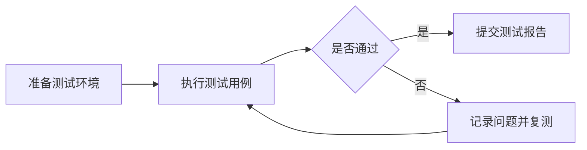

# 测试报告图表

测试结果和测试报告编辑器提供“插入图表”按钮。点击后在弹窗中选择类型、填写标题，并在表格里输入分类与数值；支持增加或删除分类和数据组，右侧实时预览。确认后自动生成并插入 Markdown 图表，无需编写 JSON。柱状图与折线图最多支持 100 个分类、10 组数据；饼图只使用第一组数据，数值不能为负且不能全部为零。流程图可填写步骤并选择排列方向，自动按顺序连接。报告弹窗和 A4/A5 打印使用同一套图表；无需上传截图。

现有 Markdown 标题、表格、任务清单、截图和附件仍然可用。图表直接保存在报告的 Markdown 中，不会根据申请状态自动推算用例数量。

## 数据图表

使用 `chart` 代码块，内容为 JSON：

```chart
{
  "type": "bar",
  "title": "各模块用例执行情况",
  "labels": ["登录", "权限", "文件上传"],
  "series": [
    { "name": "通过", "data": [12, 8, 6] },
    { "name": "失败", "data": [0, 2, 1] }
  ]
}
```

- `type`：`bar` 柱状图、`line` 折线图、`pie` 饼图。
- `title`：图表标题，可在标题中注明单位，如“响应时间（ms）”。
- `labels`：各数据点或饼图分类的名称，最多 100 个。
- `series`：数据系列，最多 10 组；每组 `data` 数量应与 `labels` 一致，数值必须是有效数字。饼图仅支持一组非负数。

图表下方显示对应数据表，便于核对和打印。图表不执行 JavaScript，也不接受任意 ECharts 配置。

## 流程图

使用 Mermaid 描述测试流程：



Mermaid 在严格模式下渲染，最多 20,000 字符、300 条连线。内容较多时建议拆为多张图。

## 打印

详情页顶部的“打印全部报告”固定包含该申请的全部历史报告，先打开应用内打印预览。报告弹窗中的“预览并打印本份报告”仅预览该份。

打印采用简洁的白底排版：深色标题、青绿色章节标记、分组信息区及横线表格。A4 信息区使用四列，A5 使用两列；预览与浏览器直接打印共用文档样式。

预览支持 A4/A5 分页、页码、25%–300% 放大缩小、适合宽度。页面顶部显示报告份数和总页数，可滚动查看全部纸张。预览会等待图表、字体、图片准备完成；切换纸张会重新分页。

检查完成后，点击“确认并打印”才调用系统打印窗口。打印使用预览中已经分页的文档，预览缩放不影响纸张尺寸和内容大小。图表以 SVG 输出，放大仍然清晰。

语法错误时保留原始代码和错误提示，便于修改；打印时也保留这些信息。若图表加载超时，页面提示稍后重试，不输出未完成的图表。
